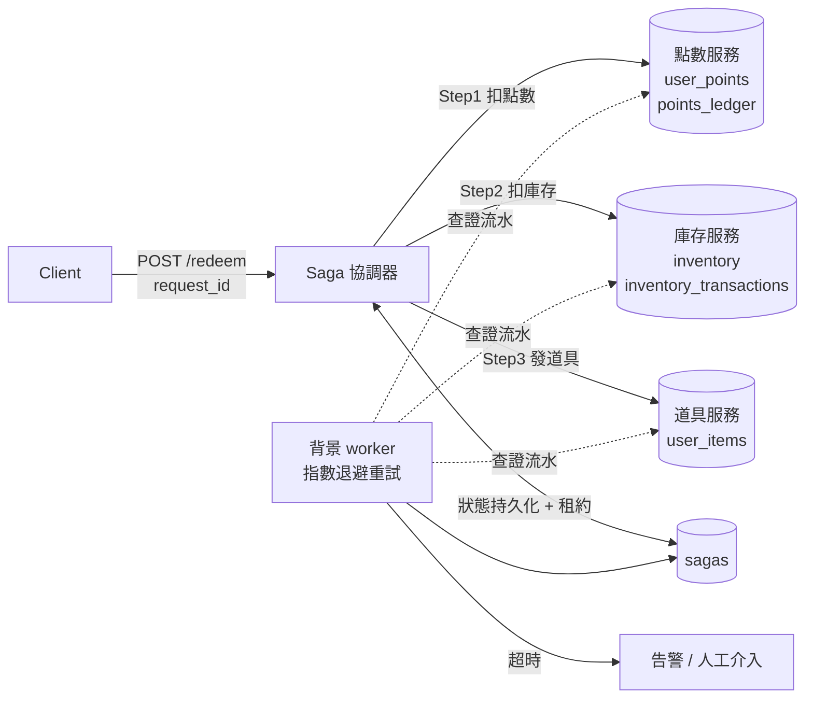

# saga-points-demo

[](https://github.com/gg10261018-star/sagaTest/actions/workflows/ci.yml)

用 Golang + MySQL 實作「點數兌換道具」的 **Saga 分散式交易**，重點放在三件事：

1. **冪等性**：同一個請求送幾次、併發送幾次，都只生效一次（三層防護）
2. **補償機制**：任一步失敗，反向、接力式補償；補償失敗就指數退避重試，超時升級人工
3. **可查證**：所有點數異動寫入**只新增不修改的流水表**，排程撈到「太久沒做完」的兌換時，先到流水查證實際做到哪，再依證據補償

所有行為都有**連真實 MySQL 的整合測試**，含併發測試與 `-race` 檢查。

---

## 架構



```
正向：  Step1 扣點數 ──▶ Step2 扣庫存 ──▶ Step3 發道具 ──▶ completed
                                          │ 失敗
補償：  退點數 ◀──────── 補庫存 ◀──────── 收道具          （反向、接力，不跳步）
          │ 失敗
          └─▶ 指數退避重試 ─▶ 重試 N 次：低優先級告警 ─▶ 超過時限：needs_manual + 高優先級告警
```

> 三個服務在這個 Demo 裡共用同一個 MySQL，但**刻意不共用交易**——每個服務各自 commit，
> 協調器完全不能依賴資料庫 `ROLLBACK`，跟真實的跨服務情境一樣。

### Saga 狀態機

| 狀態 | 意義 |
|---|---|
| `pending` | 正向流程進行中 |
| `completed` | 全部成功 |
| `failed` | 第一步就被業務拒絕（例如點數不足），沒有東西需要補償 |
| `compensating` | 補償中（可能在等背景重試） |
| `compensated` | 補償完成，系統回到一致狀態 |
| `needs_manual` | 補償超過時限仍失敗，已升級人工 |

---

## 設計重點

### 1. 三層冪等防護（`internal/points/points.go`）

| 層 | 做法 | 解決什麼 | 擋不住什麼 |
|---|---|---|---|
| 1 | 先查流水表 `request_id` | 絕大多數重送，最快路徑 | 兩個請求幾乎同時查 → 都查到「沒處理過」 |
| 2 | `SELECT ... FOR UPDATE` 鎖餘額 + **鎖內二次檢查** | 併發扣款算錯餘額；排隊者醒來誤判 | 新使用者（沒有資料列可鎖） |
| 3 | 流水表 `request_id` **唯一鍵** | 最終防線，寫入那一刻資料庫一定擋下第二筆 | — |

**鎖內二次檢查是實測出來的**：拿掉它之後，「餘額 100、同一筆扣 80 的請求併發送 20 次」，
會有 3～17 個請求錯誤地回「點數不足」——因為排隊者拿到鎖時，看到的是已經被扣過的餘額。
扣款金額本身還是對的（第三層擋住了），但使用者會收到錯誤的訊息。

**新使用者的漏洞**：`FOR UPDATE` 只能鎖已存在的列。全新使用者時，`INSERT` 撞唯一鍵 → 改用 `FOR UPDATE` 鎖住對方建好的那列，沿用繼續。
這個路徑在併發下可能觸發 InnoDB 死鎖（兩個請求都持有重複鍵的 S 鎖、都想升級成 X 鎖），所以外層包了 `WithDeadlockRetry`。

### 2. 點數流水表（`points_ledger`）

```
request_id | saga_request_id | biz_type      | delta | balance_before | balance_after
-----------+-----------------+---------------+-------+----------------+--------------
deduct_points:demo-2 | demo-2 | redeem_deduct | -100  | 900            | 800
comp:deduct_points:demo-2 | demo-2 | redeem_refund | +100 | 800      | 900
```

- **只新增、不修改、不刪除**：流水是事實的來源，`user_points.balance` 只是流水的加總快取
- 每列可單獨驗算 `before + delta = after`；`Reconcile()` 檢查「餘額 = 流水加總」，所有測試結束時都會對帳
- `saga_request_id` 把同一次兌換的扣點、退點串在一起，人工查帳一個查詢就看完

### 3. 結果不確定時的補償（空補償 + 懸掛）

錯誤分兩類（`internal/errs`）：

- **確定的業務拒絕**（點數不足、庫存不足）→ 這一步確定沒執行，從前一步開始補償
- **暫時性錯誤**（逾時、斷線）→ **不確定**：下游可能已經成功、只是回應遺失。所以**連同這一步一起補償**

連同不確定的步驟一起補償，會帶出兩個邊界情況：

| 問題 | 情境 | 解法 |
|---|---|---|
| 空補償 | 正向根本沒執行，卻收到補償 | 補償前先查流水，查不到就不退 |
| 懸掛 | 補償先跑完，正向請求才**晚到** | 查不到時用**正向 request_id 寫一筆 `void` 作廢標記**；晚到的正向請求撞唯一鍵、看到 void → 拒絕 |

誰先寫入誰贏，一樣由唯一鍵裁決，不靠時間差賭運氣。

### 4. 反向接力補償

- 補償順序跟正向相反（先收道具 → 補庫存 → 退點）
- **不跳步**：第 N 步補償沒成功，就不會去做第 N-1 步。每補完一步就持久化 `comp_next`
- 好處：任何時間點中斷，狀態都是「後面已復原、前面還沒」，可解釋，不會東補一塊西空一塊

### 5. 補償失敗：指數退避 + 時限 + 分層告警

- 正向失敗可以放棄；**補償必須想辦法成功** → 不放棄，排程背景重試
- 退避：`base × 2^(n-1)`，上限 `BackoffMax`，再乘上 `[0.5, 1]` 的隨機抖動，避免大量失敗的 saga 同時重試、對剛恢復的下游造成二次衝擊
- 重試達 `WarnAfterRetries` 次 → 低優先級告警；超過 `CompensationDeadline` → `needs_manual` + 高優先級告警
- 時限沒有標準答案：取決於故障的預期恢復時間，以及卡在哪個業務環節（點數可寬鬆；金流、庫存應縮短、提早介入）

### 6. 中斷恢復：排程查證流水

程式在流程中途崩潰時，`sagas` 表的進度可能落後於實際（例如庫存已扣，但 `current_step` 還沒寫回）。
背景 worker 撈到「`pending` 超過 `StuckPendingAfter` 且租約已過期」的 saga 時：

1. 對每一步呼叫 `Probe()`，到各服務流水查證：`none` / `applied` / `compensated` / `voided`
2. 補償起點 = `max(流水裡最後一個 applied 的步驟, 當時正在執行的那一步)`
3. 查證結果寫進 `last_error`，例如：
   `流程中斷：停在 step 2 超過 2m0s 未更新，轉入補償。流水查證：deduct_points=applied, deduct_stock=applied, grant_item=none`

**為什麼不完全相信流水？** 當時正在執行的那一步查不到流水，不代表它不會生效——請求可能還卡在網路上。把它納入補償，下游會寫作廢標記擋掉晚到的請求。流水證據的價值是讓決策跟告警**有憑有據**，人工介入時一眼看懂現場。

**為什麼中斷後選擇退款，而不是幫使用者把剩下的步驟做完？** 使用者在中斷當下已經收到逾時 / 失敗回應，「默默在背景幫他完成」反而容易造成誤解跟重複兌換；退款後讓使用者重新兌換，語意最清楚。這是取捨不是定律——如果業務上「一定要給到道具」（例如已付現金購買），就應該改成向前恢復（forward recovery）。

### 7. 租約：避免同一個 saga 被同時推進

同一個 `request_id` 併發進來、或多台機器的 worker 同時掃描時，必須先用條件式 `UPDATE` 搶租約。
之後每次寫回都帶 `WHERE lease_owner = ?`，租約被別人接手時寫回會失敗（fencing），舊的處理者就停手。

---

## 測試

```bash
docker compose up -d mysql      # 或使用自己的 MySQL，以 TEST_MYSQL_DSN 指定
go test ./... -race -count=1 -v
```

> **注意**：整合測試需要真實的 MySQL。連不上時測試會 **Skip** 而不是失敗，
> 不加 `-v` 只會看到 `ok`，容易誤以為測過了。想確保真的有連上資料庫，可以設定
> `REQUIRE_MYSQL=1`，連不上就直接失敗。CI（GitHub Actions）每次 push 都會起一個 MySQL 8.0、
> 開啟 `REQUIRE_MYSQL` 跑完整測試。

| 測試 | 驗證內容 |
|---|---|
| `TestConcurrentDuplicateRequest_DeductsOnce` | 同一請求併發 20 次、餘額只夠扣一次 → 只扣一次，20 個都回成功 |
| `TestNaive_WithoutIdempotency_DeductsManyTimes` | 反面教材：沒有冪等性時，按一次被扣 10 次 |
| `TestConcurrentDifferentRequests_NoOverspend` | 20 個不同請求搶 100 點 → 剛好 10 成功，不扣成負數 |
| `TestNewUser_ConcurrentFirstOperation` | 新使用者 20 個請求同時加點，資料列建立競爭 |
| `TestLedger_EveryEntryIsSelfConsistent` | 每一筆流水都能單獨驗算 `before + delta = after` |
| `TestCompensate_IsIdempotent` | 補償併發觸發 10 次 → 只退一次 |
| `TestCompensateBeforeForward_EmptyCompensationAndHanging` | 補償先到 → 不退點；正向晚到 → 被擋下 |
| `TestHappyPath` | 正常兌換，流水一筆扣點 |
| `TestInsufficientPoints_FailsWithoutCompensation` | 第一步業務拒絕 → `failed`，不補償 |
| `TestOutOfStock_CompensatesOnlyPoints` | 第二步業務拒絕 → 只補償第一步 |
| `TestGrantFails_ReverseCompensation` | 補償順序為 收道具 → 補庫存 → 退點；晚到的發道具請求被擋 |
| `TestStockSucceededButResponseLost_StillCompensated` | 下游其實成功但回應遺失 → 仍正確補回庫存 |
| `TestRelay_DoesNotSkipFailedCompensation` | 補庫存一直失敗時，不會跳過去先退點 |
| `TestCompensationRetry_WithBackoff` | 退避間隔遞增（實測約 1s → 2.6s → 7.7s）、重試成功、只發低優先級告警 |
| `TestCompensationDeadline_EscalatesToManual` | 超過時限 → `needs_manual`，warning ×1、critical ×1 |
| `TestConcurrentSameRedeem_OnlyOnce` | 同一兌換併發 10 次 → 只兌換一次 |
| `TestSameRequestIDDifferentPayload_Rejected` | 相同 `request_id` 帶不同參數 → 視為客戶端錯誤，拒絕 |
| `TestCrashedSaga_ProbedFromLedgerAndCompensated` | 模擬崩潰：排程查證流水、依證據補償、留下查證紀錄 |

時間相關的測試使用可快轉的假時鐘（`internal/clock`），不需要真的等待退避或時限。

---

## 本機 Demo

```bash
docker compose up --build
./scripts/demo.sh
```

或手動：

```bash
# 正常兌換
curl -X POST localhost:8080/redeem -H 'Content-Type: application/json' \
  -d '{"request_id":"demo-1","user_id":1001,"item_id":1,"cost":100}'

# 製造故障：發道具永遠失敗、退點的補償前 2 次失敗
curl -X POST localhost:8080/admin/chaos -d '{"step":"grant_item","exec_failures":-1}'
curl -X POST localhost:8080/admin/chaos -d '{"step":"deduct_points","comp_failures":2}'
curl -X POST localhost:8080/redeem -H 'Content-Type: application/json' \
  -d '{"request_id":"demo-2","user_id":1001,"item_id":1,"cost":100}'

# 幾秒後背景 worker 會完成補償
curl localhost:8080/sagas/demo-2          # 狀態、重試次數
curl localhost:8080/sagas/demo-2/ledger   # 點數流水：扣 100 → 退 100
curl localhost:8080/sagas/demo-2/probe    # 即時查證每一步的真實狀態
```

| API | 說明 |
|---|---|
| `POST /redeem` | 發起兌換（`request_id` 為冪等鍵） |
| `GET /sagas/{request_id}` | 查詢 saga 狀態 |
| `GET /sagas/{request_id}/ledger` | 該次兌換的點數流水 |
| `GET /sagas/{request_id}/probe` | 到各服務流水查證每一步的真實狀態 |
| `GET /users/{user_id}/points` | 點數餘額 |
| `GET /items/{item_id}/stock` | 庫存 |
| `POST /admin/chaos` | 故障注入：`exec_failures` / `comp_failures`（-1 = 永遠）、`fail_after`（下游成功但回應遺失） |
| `POST /admin/recover` | 立刻執行一輪背景 worker |

---

## 專案結構

```
cmd/server/            HTTP 服務 + 背景 worker 進入點
internal/
  points/              點數服務：三層冪等防護、流水表、補償、查證、對帳
  inventory/           庫存服務
  items/               道具服務
  saga/
    orchestrator.go    正向流程、反向接力補償、指數退避、中斷恢復（查證流水）
    store.go           sagas 表存取、租約
    steps.go           三個步驟（Execute / Compensate / Probe）
    chaos.go           故障注入
    alert.go           分層告警介面
  db/                  連線、建表、MySQL 錯誤碼（1062 / 1213）
  clock/               可快轉的時鐘（測試用）
  testdb/              整合測試用的真實資料庫
```

---

## 已知限制與可以延伸的方向

- **單體部署的簡化**：三個「服務」以 Go package 直接呼叫。拆成獨立服務時，呼叫改走 gRPC，冪等鍵跟查證介面不需要改變
- **補償前的狀態變化**：如果使用者在兌換後、補償前已經把點數花掉，退點不受影響（是加點），但「收回道具」可能遇到道具已被使用。真實系統需要定義業務規則（改扣等值點數、或升級人工）
- **觀測性**：告警目前只寫 log；可接 Slack / Telegram，並把 `compensating` 數量、補償重試次數做成 Prometheus metric
- **Outbox**：目前 saga 狀態跟各服務的寫入不在同一個交易，中斷時靠「查證流水」補救；另一種常見做法是 Transactional Outbox + 訊息佇列

## 在 Windows 本機執行

```powershell
docker compose up -d mysql
$env:TEST_MYSQL_DSN = "saga:saga@tcp(127.0.0.1:3306)/"
go test ./... -count=1 -v
```
（`-race` 在 Windows 需要 cgo / gcc，沒有安裝的話先拿掉這個參數）
